In this project we build & compare Convolutional Neural Networks to automatically categorise e-commerce product images, with the goal of helping an online fashion retailer tag new products faster and more accurately.

**Full code & notebooks:** [View on GitHub](https://github.com/lemuelhmgs12/fashion-product-classification)

# Table of contents

- [00. Project Overview](#overview-main)
    - [Context](#overview-context)
    - [Actions](#overview-actions)
    - [Results](#overview-results)
    - [Growth/Next Steps](#overview-growth)
- [01. Data Overview](#data-overview)
- [02. Data Preparation](#data-preparation)
- [03. Data Pipeline](#data-pipeline)
- [04. CNN Overview](#cnn-overview)
- [05. Baseline Network](#cnn-baseline)
- [06. Tackling Overfitting With Dropout](#cnn-dropout)
- [07. Image Augmentation](#cnn-augmentation)
- [08. Hyper-Parameter Tuning](#cnn-tuning)
- [09. Transfer Learning](#cnn-transfer-learning)
- [10. Error Analysis](#error-analysis)
- [11. Overall Results Discussion](#cnn-results)
- [12. Growth & Next Steps](#growth-next-steps)

___

# Project Overview  <a name="overview-main"></a>

### Context <a name="overview-context"></a>

Our client, an online fashion retailer, has thousands of new products uploaded by sellers every week. Each product needs to be placed into the right category - such as T-shirts, shirts or shoes - so that customers can find it through search & filters.

Today this is done manually. It is slow, and mistakes are costly - a shirt listed under T-shirts is effectively invisible to a customer searching for shirts, which means lost sales.

The client asked us for a proof of concept: can a Convolutional Neural Network correctly categorise a product from its image alone?

<br>
<br>
### Actions <a name="overview-actions"></a>

We used the Fashion Product Images dataset from Kaggle, focusing on six product categories - including two pairs of look-alike categories (Tshirts & Shirts, Casual Shoes & Sports Shoes) to make the task realistic. We took a balanced sample of 1,000 images per category, and split them into training (60%), validation (30%) and test (10%) sets.

We built our networks using *Keras*, and improved them step by step - changing one thing at a time so we could measure the effect of each change:

* **Baseline Network** - 2 Convolutional blocks (32 filters each) and a single Dense layer (32 neurons)
* **Dropout** - added to tackle the strong overfitting seen in the baseline
* **Image Augmentation** - random flips, rotations, zooms & shifts of the training images
* **Hyper-Parameter Tuning** - using *keras-tuner* to search for a better architecture. The best network had 3 Convolutional blocks (128, 96 & 32 filters) and a Dense layer of 64 neurons
* **Transfer Learning** - using **MobileNetV2**, a network pre-trained on over a million images, with our own layers added on top

For each network, we looked beyond overall accuracy - at accuracy for each category, the network's confidence, and its mistakes. We also checked whether the product labels themselves could be trusted.

<br>
<br>

### Results <a name="overview-results"></a>

In terms of Classification Accuracy on the Test Set, we saw:

* Baseline Network: **92.3%**
* Baseline + Dropout: **91.5%**
* Baseline + Image Augmentation: **87.7%**
* Tuned Architecture + Image Augmentation: **89.5%**
* Transfer Learning Using MobileNetV2: **92.7%**

Transfer Learning was the strongest network overall. It matched the accuracy of our best custom network, but with far more realistic confidence (test loss of 0.23 vs 0.58 for the baseline), the best accuracy across categories, and just 20 epochs of training.

Some key findings:

* **Overfitting** - our baseline network memorised the training images (100% training accuracy). Dropout largely fixed this without losing accuracy
* **Image Augmentation lowered accuracy** - unlike in many projects, as these product photos are highly standardised (centred, on white backgrounds), so the network was learning to handle variation that never appears in practice
* **Shoes are the hardest category** - every network struggled to separate Casual Shoes & Sports Shoes (around 80-85% accuracy). A check against the product names showed the labels are correct - the two categories are defined by intended use rather than appearance, which an image alone cannot fully show

From a business point of view, the network's confidence can be used to decide which products to tag automatically. Only auto-tagging products the Transfer Learning network is at least 90% confident about covers **70% of products at 98.3% accuracy**, with the rest sent to the team for review.

<br>
<br>
### Growth/Next Steps <a name="overview-growth"></a>

The proof of concept was successful - the network can categorise most products very accurately, and can tell the team which predictions to trust.

Next, we would like to:

* Test the approach on more product categories, and with higher resolution images
* Fine-tune the pre-trained network, and compare it against newer networks such as EfficientNetV2
* Use the product name alongside the image, to help separate categories like Casual & Sports Shoes, which images alone cannot fully tell apart

<br>
<br>

___

# Data Overview  <a name="data-overview"></a>

For this proof of concept we use the [Fashion Product Images (Small)](https://www.kaggle.com/datasets/paramaggarwal/fashion-product-images-small) dataset from Kaggle - around 44,000 real product images from an online fashion store, along with a `styles.csv` file containing the details of each product.

The product details include:

* id (which matches the image file name, e.g. 15970.jpg)
* gender
* masterCategory, subCategory & articleType - the product category, from broad (e.g. Apparel) to specific (e.g. Tshirts)
* baseColour, season, year & usage
* productDisplayName

The *articleType* column contains over 140 product categories. For our proof of concept we selected six, including two pairs of look-alike categories, to make the task realistic:

* Tshirts & Shirts
* Casual Shoes & Sports Shoes
* Watches
* Handbags

Examples of four images from each category can be seen below:

<br>
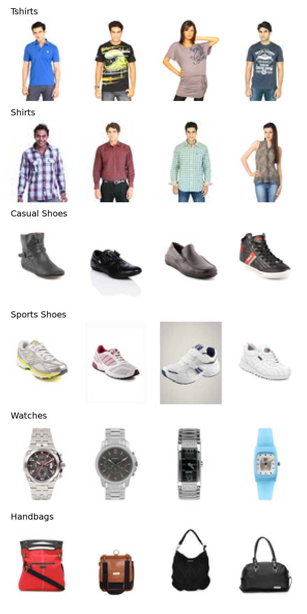

<br>
The images are small, low-resolution product photos - 5,997 of our 6,000 images are 60 pixels wide and 80 pixels tall. Most are taken in a studio, centred on a white background, and 61 of the 6,000 images (1%) are greyscale.

___
<br>
# Data Preparation  <a name="data-preparation"></a>

Unlike a dataset that comes ready-split into folders, our images all sit in a single folder, with their labels stored separately in `styles.csv`. Before building any networks, we need to turn this into the folder structure that Keras expects - training, validation & test folders, each split into one sub-folder per category.

All file paths & settings (such as the six categories, the image size, and the random seed) are stored in a single `config.py` file, so every notebook uses exactly the same values.

<br>
#### Loading The Labels

A small number of rows in `styles.csv` have commas within the product name, which breaks the file's structure. We skip these rows, and measure how many were lost, rather than dropping them silently.

```python

# import labels - a few rows have commas inside the product name, so we skip rows that can't be parsed
styles = pd.read_csv(config.STYLES_CSV, on_bad_lines="skip")

# how many rows did we lose?
with open(config.STYLES_CSV, encoding="utf-8") as f:
    total_rows = sum(1 for _ in f) - 1   # minus the header row

print(f"Rows in file: {total_rows}, loaded: {len(styles)}, skipped: {total_rows - len(styles)}")

>> Rows in file: 44446, loaded: 44424, skipped: 22

```

<br>
#### Checking Every Label Has An Image

The labels and images are stored separately, so we check that each product has a matching image. Rather than checking 44,000 files one at a time, we read the image folder once, and compare product ids against it.

```python

# get the ids of every image in the folder, e.g. "15970.jpg" -> "15970"
image_ids = {path.stem for path in config.RAW_IMAGES_DIR.glob("*.jpg")}

# check which products have an image
styles["image_exists"] = styles["id"].astype(str).isin(image_ids)

# keep only products that have an image
styles = styles.loc[styles["image_exists"]].copy()

```

In summary:

| **Step** | **Result** |
|---|---|
| Rows in `styles.csv` | 44,446 |
| Rows skipped (could not be parsed) | 22 (0.05%) |
| Products without an image | 5 |
| Products with an image | 44,419 |

<br>
#### Balancing The Categories

Our six categories are very uneven in size - there are far more T-shirts than handbags, for example. If we trained on them as they are, the network would see some categories far more often than others, and learn to favour them.

To give every category equal attention, we take a random, balanced sample of 1,000 images from each category - 6,000 images in total.

```python

# keep only the categories we're classifying
product_data = styles.loc[styles["articleType"].isin(config.CLASSES), ["id", "articleType", "filepath"]].copy()

# take the same number of images from each category (capped by the smallest category)
smallest_class = product_data["articleType"].value_counts().min()
images_per_class = min(config.IMAGES_PER_CLASS, smallest_class)

sampled_data = product_data.groupby("articleType").sample(n=images_per_class, random_state=config.RANDOM_SEED)

```

<br>
#### Splitting Into Training, Validation & Test Sets

We split our 6,000 images into training (60%), validation (30%) and test (10%) sets. As `train_test_split` can only split data into two parts, we split twice - first into training & a held-back set, then the held-back set into validation & test.

We use the *stratify* parameter so that every set contains exactly the same mix of categories.

```python

# first split: 60% training, 40% held back for validation & test
train_data, test_validate_data = train_test_split(sampled_data,
                                                  train_size=config.TRAIN_SPLIT,
                                                  stratify=sampled_data["articleType"],
                                                  random_state=config.RANDOM_SEED)

# second split: divide the 40% into validation (30%) and test (10%)
# use a whole number of rows - fractions like 0.3 / 0.4 can come out as 0.7499999... and lose a row
validation_share = config.VALIDATION_SPLIT / (config.VALIDATION_SPLIT + config.TEST_SPLIT)
validation_size = round(validation_share * len(test_validate_data))

validation_data, test_data = train_test_split(test_validate_data,
                                              train_size=validation_size,
                                              stratify=test_validate_data["articleType"],
                                              random_state=config.RANDOM_SEED)

```

**Note:** Our first attempt produced 601 test images instead of 600. This was caused by floating-point rounding - in Python, 0.3 / 0.4 gives 0.7499999999999999 rather than 0.75, so one image was lost from the validation set. Using a whole number of rows fixed this.

This gives us:

| **Set** | **Share** | **Images** | **Per category** |
|---|---|---|---|
| Training | 60% | 3,600 | 600 |
| Validation | 30% | 1,800 | 300 |
| Test | 10% | 600 | 100 |

The training set is used to train each network, and the validation set is used to make decisions during development - such as choosing the best epoch, and the best architecture. The test set is only used at the very end, to give an honest measure of how each network performs on images it has never seen.

<br>
#### Building The Folder Structure

Finally, we copy each image into its folder. The folders are deleted & rebuilt each time, so re-running the notebook never mixes old & new images. We also save a record of which image went into which set (`splits.csv`), so any result can be traced back to its image.

```python

# which data goes into which folder
splits = {config.TRAINING_DIR: train_data,
          config.VALIDATION_DIR: validation_data,
          config.TEST_DIR: test_data}

for split_dir, split_data in splits.items():

    # start fresh, so re-running this notebook never leaves old images behind
    if split_dir.exists():
        shutil.rmtree(split_dir)

    for _, row in split_data.iterrows():
        class_dir = split_dir / row["articleType"]
        class_dir.mkdir(parents=True, exist_ok=True)
        shutil.copy(row["filepath"], class_dir / row["filepath"].name)

```

Keras uses the folder names as the category labels - for example, an image in `training/Watches/` is labelled as a Watch.

___
<br>
# Data Pipeline  <a name="data-pipeline"></a>

Before building any networks, we need a pipeline that loads our images from the folders, and passes them into the network in batches.

We use Keras' `image_dataset_from_directory`, rather than the older `ImageDataGenerator` - which is now deprecated. It is built on TensorFlow's faster `tf.data` pipeline, which can prepare the next batch of images while the current one is training.

In the code below, we:

* Load the training, validation & test images from their folders
* Keep each image at its original size (80 pixels tall, 60 wide)
* Pass images in batches of 32
* Convert each label into a *one-hot* format - for example, a Watch becomes [0, 0, 0, 0, 0, 1]

```python

# training data - shuffled so each batch contains a random mix of categories
training_set = tf.keras.utils.image_dataset_from_directory(
    config.TRAINING_DIR,
    image_size = (config.IMG_HEIGHT, config.IMG_WIDTH),   # (height, width)
    batch_size = config.BATCH_SIZE,
    label_mode = "categorical",                           # one-hot labels
    shuffle = True,
    seed = config.RANDOM_SEED
)

# validation data - not shuffled, order doesn't affect the score
validation_set = tf.keras.utils.image_dataset_from_directory(
    config.VALIDATION_DIR,
    image_size = (config.IMG_HEIGHT, config.IMG_WIDTH),
    batch_size = config.BATCH_SIZE,
    label_mode = "categorical",
    shuffle = False
)

# test data - not shuffled, so predictions & true labels stay in the same order
test_set = tf.keras.utils.image_dataset_from_directory(
    config.TEST_DIR,
    image_size = (config.IMG_HEIGHT, config.IMG_WIDTH),
    batch_size = config.BATCH_SIZE,
    label_mode = "categorical",
    shuffle = False
)

>> Found 3600 files belonging to 6 classes.
>> Found 1800 files belonging to 6 classes.
>> Found 600 files belonging to 6 classes.

```

<br>
A few details here are important:

* **Image size order** - Keras expects image sizes as *(height, width)*. Our images are not square, so swapping these would turn every image on its side
* **Keeping the original size** - we do not resize to a square (such as 64 x 64), as this would squash every product out of shape, and enlarging the images would not add any real detail
* **Shuffling** - the training set is reshuffled every epoch, so each batch contains a different random mix of categories. The test set is *not* shuffled - when evaluating, we loop through it once to get the predictions & once to get the true labels, so the order must stay the same, or we would be comparing the prediction for one image with the label of another
* **Category order** - Keras sorts the categories alphabetically by folder name (Casual Shoes, Handbags, Shirts, Sports Shoes, Tshirts, Watches) - so we always use this order when turning predictions back into category names

We also do not rescale the pixel values (from 0-255 down to 0-1) in the pipeline, as many tutorials do. Instead, we add a *Rescaling* layer inside each network. This means the rescaling is saved with the network, and is applied automatically to any new image - so nobody using the network later can forget it.

___
<br>
# Convolutional Neural Network Overview <a name="cnn-overview"></a>

Convolutional Neural Networks (CNNs) are a type of neural network designed for image-based tasks.

To a computer, an image is simply a grid of numbers. Each of our images is 80 x 60 pixels, and each pixel has three values between 0 and 255 - one each for Red, Green & Blue. That gives 14,400 numbers per image. The network's job is to turn these numbers into a prediction - in our case, one of our six product categories.

<br>
#### Convolution

The core of a CNN is the **Convolutional layer**. It slides many small *filters* (3 x 3 pixels in our networks) across the image. Each filter learns to detect one pattern, such as an edge or a curve, and produces a *feature map* showing where in the image it found that pattern.

Early layers learn simple patterns like edges & colors. Deeper layers combine these into more complex ones - a collar, a strap, or the sole of a shoe.

A useful property of filters is that each one is *reused* across the whole image - a filter that detects an edge works the same way wherever the edge appears. This is why Convolutional layers need relatively few parameters.

<br>
#### Pooling

After each Convolutional layer we apply **Max Pooling**. This keeps only the strongest value in each 2 x 2 area of a feature map, halving its height & width. Pooling keeps the important information (that a pattern was found), while reducing the size of the data, making the network less sensitive to the exact position of a pattern, and letting later layers see a larger area of the image.

We refer to a Convolutional layer & its Pooling layer together as a *convolutional block*.

<br>
#### Dense Layers & Output

After the convolutional blocks, the feature maps are flattened into one long list of numbers, and passed into a **Dense (Fully Connected)** layer - where every input connects to every neuron. This layer learns which combinations of features point to which category.

The final **output layer** has one neuron per category, and uses the *softmax* function to turn its scores into six probabilities that add up to 1. The category with the highest probability is the network's prediction, and that probability is its *confidence*.

As every input connects to every neuron, Dense layers usually contain most of a network's parameters - in our baseline network, 97% of them.

<br>
#### Training

During training, the network makes predictions on a batch of images, measures how wrong it was (the **loss** - we use *categorical cross-entropy*), and then works backwards through the network (**Back Propagation**) to adjust its parameters, so that it is a little less wrong next time. One full pass through all of the training images is called an **epoch**.

We use the *ReLU* activation function in our hidden layers, the *Adam* optimiser, and build each network with the Keras Functional API, which also supports the Transfer Learning network we build later.

___
<br>
# Baseline Network <a name="cnn-baseline"></a>

<br>
#### Network Architecture

Our baseline network is simple, but gives us a starting point to refine from. It contains **2 Convolutional blocks**, each with **32 filters** (3 x 3) followed by **Max Pooling**, then a **single Dense layer** with **32 neurons**, and our output layer. We use the **ReLU** activation function on all hidden layers, and the **Adam** optimiser.

These values are sensible, conventional starting points rather than tested choices - testing them is the job of the Hyper-Parameter Tuning section later.

```python

# input: image of 80 x 60 pixels, 3 color channels
inputs = tf.keras.Input(shape=(config.IMG_HEIGHT, config.IMG_WIDTH, config.NUM_CHANNELS))

# rescale pixel values from 0-255 to 0-1
x = tf.keras.layers.Rescaling(1./255)(inputs)

# convolutional block 1
x = tf.keras.layers.Conv2D(filters=32, kernel_size=(3, 3), padding="same", activation="relu")(x)
x = tf.keras.layers.MaxPooling2D()(x)

# convolutional block 2
x = tf.keras.layers.Conv2D(filters=32, kernel_size=(3, 3), padding="same", activation="relu")(x)
x = tf.keras.layers.MaxPooling2D()(x)

# flatten the feature maps into one long list of numbers
x = tf.keras.layers.Flatten()(x)

# dense layer
x = tf.keras.layers.Dense(32, activation="relu")(x)

# output layer - one probability per category
outputs = tf.keras.layers.Dense(config.NUM_CLASSES, activation="softmax")(x)

model = tf.keras.Model(inputs=inputs, outputs=outputs, name="baseline_cnn")

# compile network
model.compile(loss="categorical_crossentropy", optimizer="adam", metrics=["accuracy"])

```

<br>
The network has **317,574 parameters**. Our small images shrink from 80 x 60 to 20 x 15 after two rounds of pooling, so the Flatten layer passes 20 x 15 x 32 = 9,600 values into the Dense layer. As every one of these connects to every one of the 32 neurons, the Dense layer alone holds 307,232 parameters - 97% of the network.

<br>
#### Training The Network

We train for **50 epochs**, using a *ModelCheckpoint* callback to save the *best* network during training - the epoch with the highest validation accuracy - rather than simply the network at epoch 50.

```python

# save the best model (highest validation accuracy) during training
model_filename = config.MODELS_DIR / "fashion_cnn_v01.keras"

save_best_model = tf.keras.callbacks.ModelCheckpoint(filepath=model_filename,
                                                     monitor="val_accuracy",
                                                     mode="max",
                                                     save_best_only=True,
                                                     verbose=0)

# train the network
history = model.fit(training_set,
                    validation_data=validation_set,
                    epochs=config.NUM_EPOCHS,
                    callbacks=[save_best_model],
                    shuffle=False)       # the dataset already shuffles itself each epoch

```

<br>
#### Analysis Of Training Results

The plots below show the **Loss** (top) & **Classification Accuracy** (bottom), epoch by epoch, for the training set (blue) & the validation set (orange).

<br>
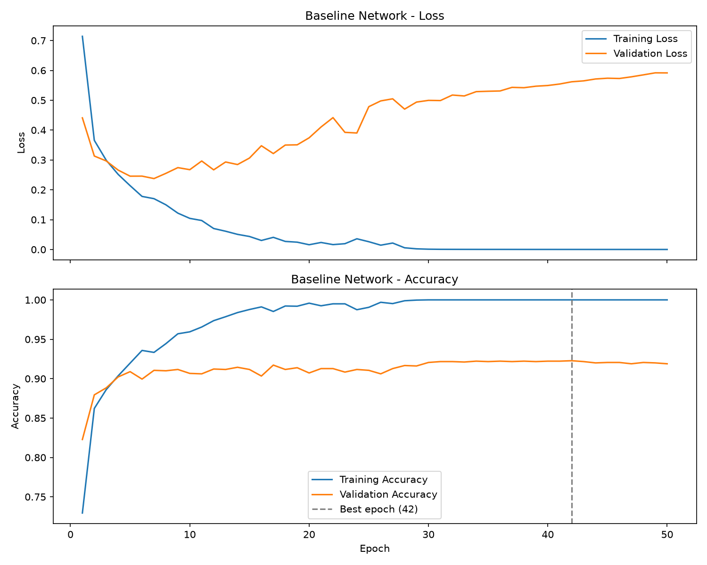

<br>
The baseline network **overfits heavily**. Training accuracy climbs to 100% by around epoch 29 - the network has memorised the training images - while validation accuracy levels off at around 92% after just 7 epochs.

The loss plot tells an even clearer story. Validation loss reaches its lowest point around epoch 7, and then rises steadily to around 0.59 by epoch 50. Validation *accuracy* stays flat while validation *loss* gets worse because accuracy only checks whether the top prediction is right, while loss also measures how confident the network was. After epoch 7 the network gets about the same number of images right, but becomes more & more confident in its mistakes.

The best validation accuracy was **92.3%**, at epoch 42.

<br>
#### Performance On The Test Set

To measure performance on images that played no part in training, we load the best saved network, and predict on the test set.

```python

# load the best model saved during training
best_model = tf.keras.models.load_model(model_filename)

# overall test accuracy & loss
test_loss, test_accuracy = best_model.evaluate(test_set, verbose=0)

# predicted probabilities for every test image, one column per category
probabilities_df = pd.DataFrame(best_model.predict(test_set, verbose=0), columns=class_names)

# true labels for every test image (same order, because test_set is not shuffled)
actual_df = pd.DataFrame(np.concatenate([labels for _, labels in test_set]), columns=class_names)

# create dataframe to analyse
predictions_df = pd.DataFrame({"actual_label": actual_df.idxmax(axis=1),
                               "predicted_label": probabilities_df.idxmax(axis=1),
                               "predicted_probability": probabilities_df.max(axis=1),
                               "filename": [Path(path).name for path in test_set.file_paths]})

predictions_df["correct"] = np.where(predictions_df["actual_label"] == predictions_df["predicted_label"], 1, 0)

```

Our baseline network achieves **92.3% Classification Accuracy** on the Test Set (554 of 600 images) - matching its best validation accuracy, which confirms that the validation set gave a reliable view of performance on new images.

<br>
#### Test Set Confusion Matrix

Overall accuracy can hide what is really going on, so we look at a confusion matrix. Rows show the *actual* category, and columns show the *predicted* category - so reading across a row shows what the network predicted for each actual category. With 100 test images per category, each count is also a percentage.

<br>


<br>
For each category we see:

* Handbags: 99%
* Watches: 98%
* Shirts: 95%
* Tshirts: 94%
* Casual Shoes: 89%
* Sports Shoes: 79%

Products with distinctive shapes - Handbags & Watches - are classified almost perfectly. The look-alike pairs cause nearly all of the mistakes, and confusion between Sports Shoes & Casual Shoes alone accounts for around two-thirds (31 of 46) of all mistakes - with 20 of 100 Sports Shoes predicted as Casual Shoes.

The network's most confident mistakes were all predicted with almost 100% certainty - another symptom of the overfitting seen during training.

___
<br>
# Tackling Overfitting With Dropout <a name="cnn-dropout"></a>

<br>
#### Dropout Overview

Dropout is a technique used to reduce overfitting. During training, for each batch of images, a set proportion of the neurons in a layer are randomly switched off - a different random set every time.

In our baseline network, some neurons became very specialised, and the network relied heavily on them to memorise the training images. With Dropout, no neuron can rely on any other neuron always being there, so the network has to spread what it learns across many neurons - making it less able to memorise individual images, and better at generalising to new ones.

Dropout only happens during training. When the network makes predictions, all neurons are used. Dropout also has nothing to learn, so our network still has **317,574 parameters** - meaning any difference in results comes from Dropout itself.

<br>
#### Updated Network Architecture

We apply Dropout to the Dense layer only, as this is where the overfitting happens - it holds 97% of the network's parameters. We use a rate of 0.5, meaning half of the Dense layer's neurons are switched off for each batch. Everything else stays exactly the same as the baseline.

```python

# dense layer
x = tf.keras.layers.Dense(32, activation="relu")(x)

# dropout - randomly switch off 50% of the dense layer's neurons during training
x = tf.keras.layers.Dropout(0.5)(x)

```

<br>
#### Analysis Of Training Results

<br>
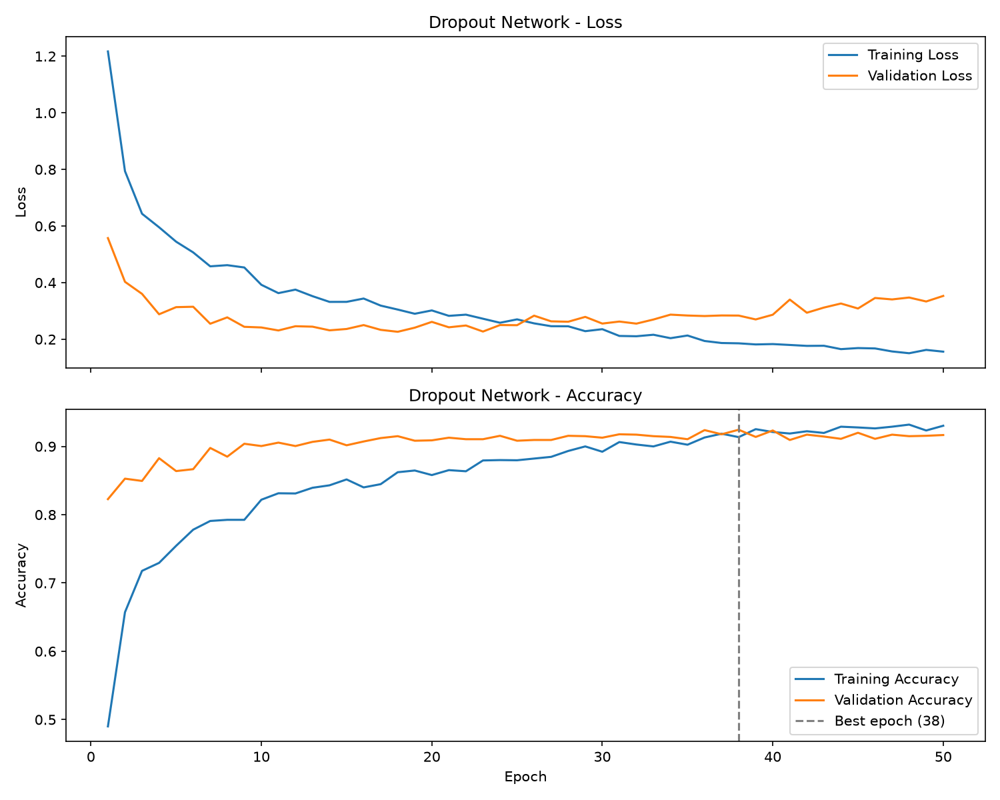

<br>
The overfitting seen in the baseline is largely removed. Training & validation accuracy now track each other closely, finishing at around 93% & 92% respectively - compared with 100% & 92% for the baseline.

Validation loss reaches its lowest point (0.23) around epoch 18, then drifts up to 0.35 by epoch 50 - some mild overfitting, but far less than the baseline (which rose to 0.59).

For much of training, validation accuracy is actually *higher* than training accuracy. This is expected with Dropout - training accuracy is measured with half of the Dense layer's neurons switched off, while validation accuracy uses all of them.

The best validation accuracy was **92.4%**, at epoch 38.

<br>
#### Performance On The Test Set

On the Test Set, the Dropout network achieved **91.5%** accuracy (549 of 600 images) - effectively the same as the baseline (554). An earlier run of this same network scored 552, so results naturally vary by a few images between runs, and a gap this small is not clear evidence that either network is better.

Test loss, however, fell by around a third - from 0.58 to 0.38 - so the network's confidence is far more realistic.

<br>
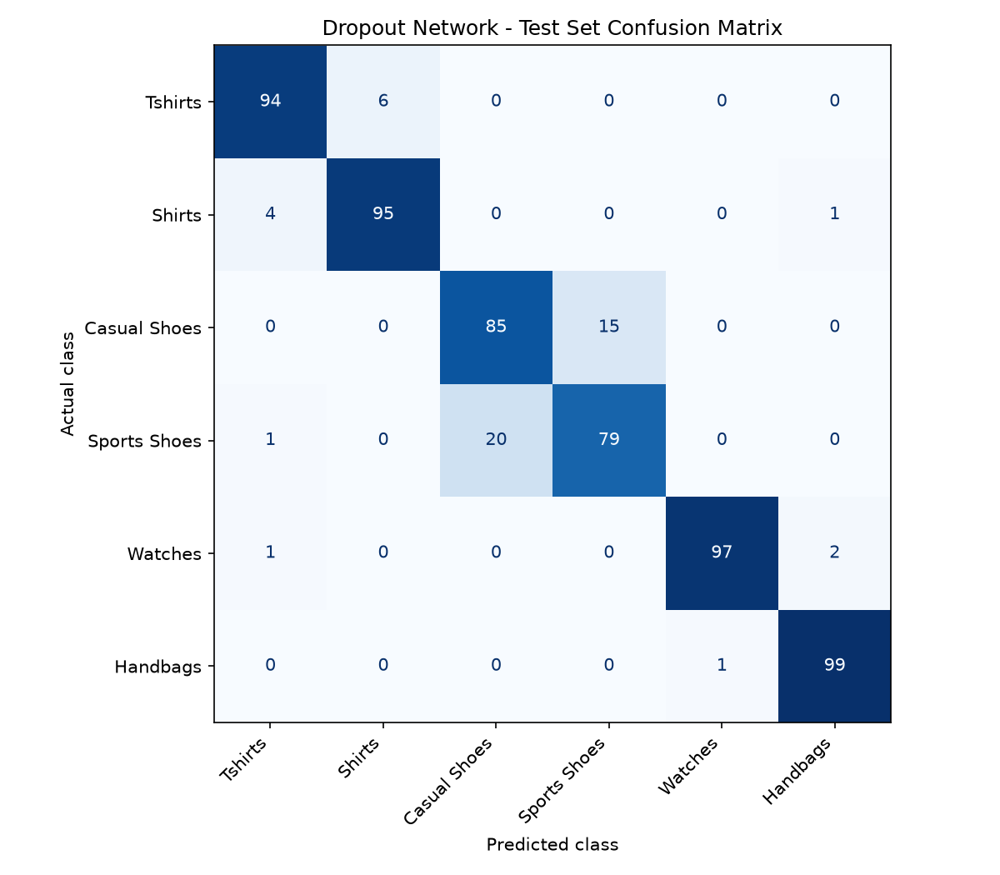

| **Category** | **Baseline** | **Dropout** |
|---|---|---|
| Handbags | 99% | 99% |
| Watches | 98% | 97% |
| Shirts | 95% | 95% |
| Tshirts | 94% | 94% |
| Casual Shoes | 89% | 85% |
| Sports Shoes | 79% | 79% |

Category accuracy is very similar to the baseline, with Sports Shoes remaining the weakest category.

<br>
#### Using Confidence To Auto-Tag Products

Because its confidence is more realistic, the Dropout network's confidence tells us something useful. Its median confidence is 99.99% on correct predictions, but 84% on mistakes.

This lets us test a simple business rule - only auto-tag products the network is at least 90% confident about, and send the rest to the team to check:

```python

# what if we only auto-tag products the model is at least 90% confident about?
threshold = 0.90

confident = predictions_df.loc[predictions_df["predicted_probability"] >= threshold]
not_confident = predictions_df.loc[predictions_df["predicted_probability"] < threshold]

print(f"Auto-tagged: {len(confident)} of {len(predictions_df)} products ({len(confident) / len(predictions_df):.0%})")
print(f"Accuracy on auto-tagged products: {confident['correct'].mean():.1%}")
print(f"Sent to a person to check: {len(not_confident)} products")

>> Auto-tagged: 531 of 600 products (88%)
>> Accuracy on auto-tagged products: 96.0%
>> Sent to a person to check: 69 products

```

The Dropout network could auto-tag 88% of products at 96.0% accuracy - with the remaining 12% sent for review. In practice, this threshold would be chosen using the validation set rather than the test set.

___
<br>
# Image Augmentation <a name="cnn-augmentation"></a>

<br>
#### Image Augmentation Overview

Image Augmentation randomly changes each training image slightly, every epoch - for example flipping, tilting, zooming or shifting it. The network never sees the exact same image twice, so there is nothing fixed to memorise - it has to learn what a product looks like in general.

We apply augmentation using Keras layers at the start of the network, rather than in the data pipeline. As with Dropout, augmentation only happens during training, has nothing to learn (so our network still has 317,574 parameters), and we apply it *without* Dropout so we can measure its effect on its own.

<br>
#### Implementing Image Augmentation

Each setting was chosen to create images that could realistically appear in a product catalogue:

```python

# image augmentation - random changes applied to each training image, every epoch
data_augmentation = tf.keras.Sequential([
    tf.keras.Input(shape=(config.IMG_HEIGHT, config.IMG_WIDTH, config.NUM_CHANNELS)),
    tf.keras.layers.RandomFlip("horizontal"),                              # mirror left-right
    tf.keras.layers.RandomRotation(0.05, fill_mode="nearest"),             # rotate up to ±18 degrees
    tf.keras.layers.RandomZoom(0.1, fill_mode="nearest"),                  # zoom in or out up to 10%
    tf.keras.layers.RandomTranslation(0.1, 0.1, fill_mode="nearest"),      # shift up to 10%
], name="data_augmentation")

```

* **Horizontal flip** - a mirrored product is still the same product. We do not flip vertically, as upside-down products never appear in a catalogue
* **Rotation** - only up to ±18 degrees, as products are photographed fairly straight
* **Zoom & shift** - up to 10%, as products are not always the same size, or perfectly centred
* **fill_mode="nearest"** - fills any gaps created by rotating or shifting with the nearest pixel, usually the white background

The image below shows one training image, and eight random augmented versions of it - each still looks like a realistic product photo.

<br>
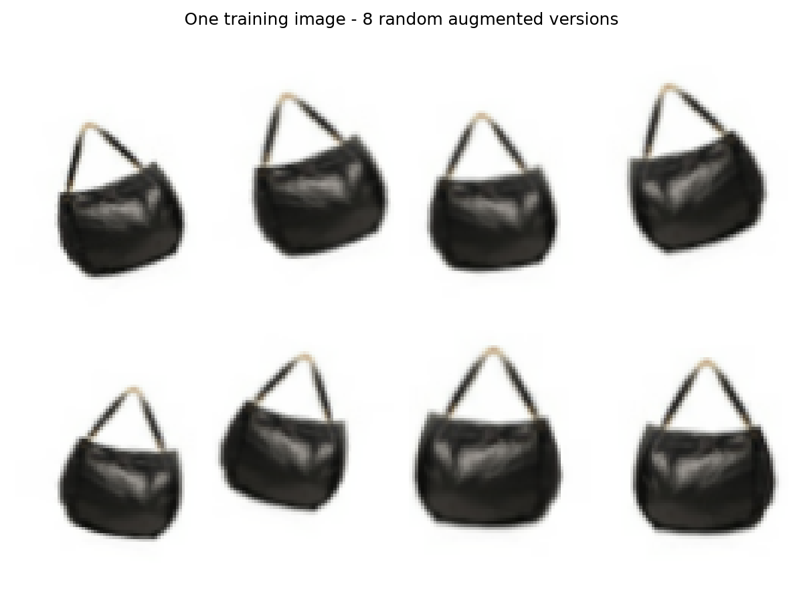

<br>
#### Analysis Of Training Results

<br>
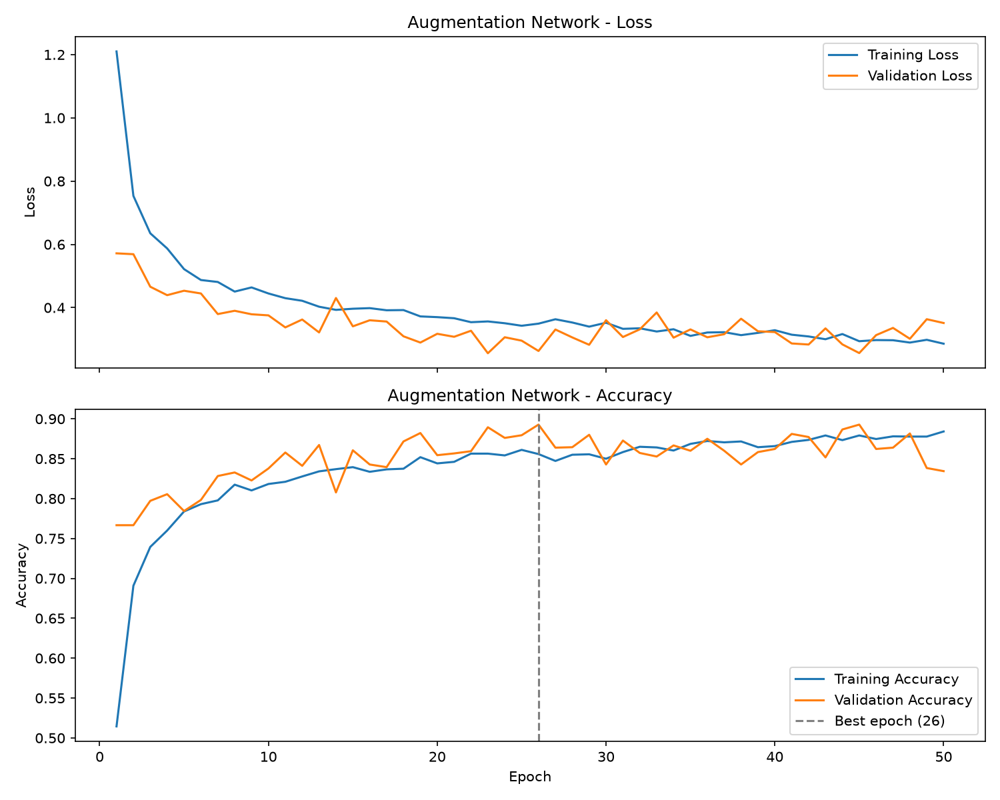

<br>
There is no clear overfitting - training & validation accuracy stay close together throughout. However, validation accuracy is unstable, swinging between 83% & 89% from epoch to epoch, with no real improvement after around epoch 20. The best validation accuracy was **89.3%**, at epoch 26.

<br>
#### Performance On The Test Set

On the Test Set, the Image Augmentation network achieved **87.7%** accuracy (526 of 600) - clearly lower than the baseline (554).

<br>
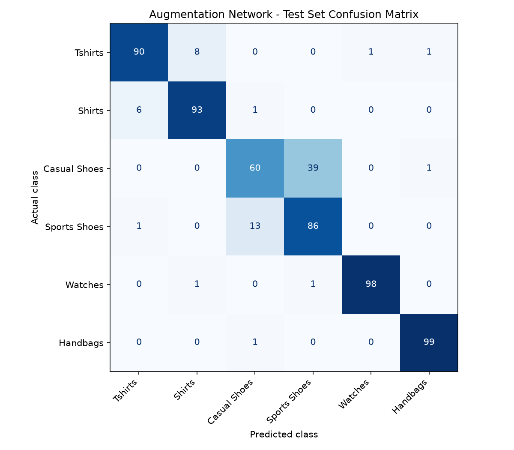

| **Category** | **Baseline** | **Dropout** | **Augmentation** |
|---|---|---|---|
| Handbags | 99% | 99% | 99% |
| Watches | 98% | 97% | 98% |
| Shirts | 95% | 95% | 93% |
| Tshirts | 94% | 94% | 90% |
| Sports Shoes | 79% | 79% | 86% |
| Casual Shoes | 89% | 85% | 60% |

Most of the drop comes from Casual Shoes, with 39 of 100 predicted as Sports Shoes. Results were also sensitive to the network's random starting weights - an earlier version of this notebook, where a small code change shifted the random starting point, scored 90.5% (Casual Shoes 79%).

Why would Image Augmentation *lower* accuracy, when it helps in so many projects? Our product photos are highly standardised - centred, on white backgrounds, in consistent studio lighting - so the test images look just like the training images. Augmentation teaches the network to handle variation (tilts, shifts, zooms) that never appears in the test set, making the task harder for this small network without much benefit.

On the positive side, it gave the most realistic confidence so far - test loss of 0.35, with a median confidence of 99.6% on correct predictions vs 70% on mistakes.

___
<br>
# Hyper-Parameter Tuning <a name="cnn-tuning"></a>

<br>
#### Keras Tuner Overview

So far, our network architecture - 2 convolutional blocks, 32 filters, 32 neurons - has been a sensible guess. Rather than testing alternatives by hand, we use *keras-tuner*, which builds & trains many networks from ranges that we specify, and tells us which performed best on the validation set.

The Image Augmentation network was still learning slowly, and was unstable, which suggested that a larger network might learn more from augmented images. So we search for a better architecture with Image Augmentation applied, and Dropout as an option.

<br>
#### Search Space

We put our network into a function, replacing fixed values with ranges for the tuner to choose from:

* **Convolutional blocks** - 1 to 3. Each block halves the image size, so our small 80 x 60 images would shrink too much beyond 3 blocks
* **Filters per convolutional layer** - 32 to 128
* **Dense layer neurons** - 32 to 256
* **Dropout** - applied or not

```python

# build a network for keras-tuner - "hp" lets the tuner choose a value from each range
def build_model(hp):

    # input & augmentation (always applied)
    inputs = tf.keras.Input(shape=(config.IMG_HEIGHT, config.IMG_WIDTH, config.NUM_CHANNELS))
    x = data_augmentation(inputs)
    x = tf.keras.layers.Rescaling(1./255)(x)

    # convolutional blocks - the tuner chooses how many (1 to 3), and how many filters each has
    num_conv_blocks = hp.Int("num_conv_blocks", min_value=1, max_value=3)

    for i in range(num_conv_blocks):
        filters = hp.Int(f"filters_{i + 1}", min_value=32, max_value=128, step=32)
        x = tf.keras.layers.Conv2D(filters=filters, kernel_size=(3, 3), padding="same", activation="relu")(x)
        x = tf.keras.layers.MaxPooling2D()(x)

    x = tf.keras.layers.Flatten()(x)

    # dense layer - the tuner chooses how many neurons
    neurons = hp.Int("dense_neurons", min_value=32, max_value=256, step=32)
    x = tf.keras.layers.Dense(neurons, activation="relu")(x)

    # dropout - the tuner chooses whether to apply it
    if hp.Boolean("dropout"):
        x = tf.keras.layers.Dropout(0.5)(x)

    outputs = tf.keras.layers.Dense(config.NUM_CLASSES, activation="softmax")(x)

    model = tf.keras.Model(inputs=inputs, outputs=outputs)
    model.compile(loss="categorical_crossentropy", optimizer="adam", metrics=["accuracy"])

    return model

```

<br>
#### Running The Search

To keep the search practical on a laptop, we tested **10 random architectures**, each trained once for up to 20 epochs, stopping early if validation accuracy did not improve for 5 epochs. The test set is not used at all during the search.

```python

# search settings
tuner = kt.RandomSearch(hypermodel=build_model,
                        objective="val_accuracy",
                        max_trials=10,
                        executions_per_trial=1,
                        seed=config.RANDOM_SEED,
                        directory=os.path.relpath(config.PROJECT_ROOT / "tuner_results"),
                        project_name="fashion_cnn",
                        overwrite=False)

# stop a trial early if validation accuracy hasn't improved for 5 epochs
stop_early = tf.keras.callbacks.EarlyStopping(monitor="val_accuracy", patience=5)

# run the search
tuner.search(training_set, validation_data=validation_set, epochs=20, callbacks=[stop_early])

```

The top 5 architectures found were:

| **Conv Blocks** | **Filters** | **Dense Neurons** | **Dropout** | **Validation Accuracy** |
|---|---|---|---|---|
| 3 | 128, 96, 32 | 64 | No | 89.2% |
| 2 | 32, 32 | 256 | Yes | 87.8% |
| 3 | 32, 96, 32 | 256 | No | 87.4% |
| 2 | 96, 32 | 64 | Yes | 85.6% |
| 2 | 32, 96 | 32 | Yes | 82.9% |

With each architecture trained only once, the differences between the top few are partly down to luck - but the pattern is clear: deeper networks, with 3 convolutional blocks, performed best.

<br>
#### Updated Network Architecture

The best architecture had **3 Convolutional blocks** (128, 96 & 32 filters) and a **Dense layer of 64 neurons**, without Dropout.

Interestingly, this network has **285,766 parameters** - *fewer* than our baseline. The third pooling step shrinks the images to 10 x 7, so the Flatten layer passes just 2,240 values into the Dense layer, compared with 9,600 for the baseline. The network spends its parameters on *seeing* (the convolutional layers) rather than *memorising* (the Dense layer).

We rebuilt this architecture & trained it for the full 50 epochs, like our earlier networks, so the results can be compared fairly.

<br>
#### Analysis Of Training Results

<br>
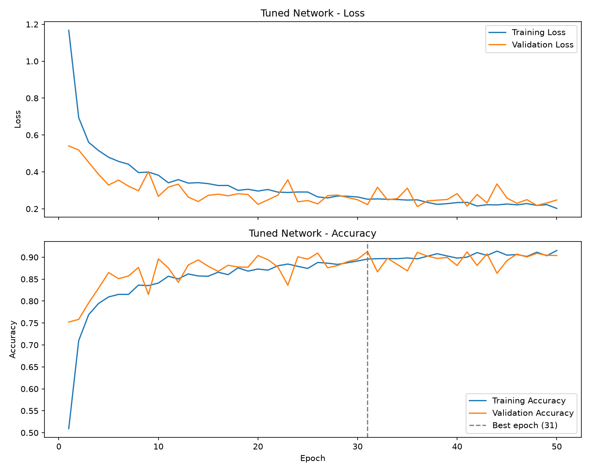

<br>
There is no overfitting - training & validation track closely throughout, and validation loss keeps falling, reaching around 0.21. Validation accuracy is more stable than the Image Augmentation network, staying between around 86% & 91% after epoch 30, and both curves are still slowly rising at epoch 50 - suggesting further training could help.

The best validation accuracy was **91.3%**, at epoch 31 - up from 89.3% for the Image Augmentation network.

<br>
#### Performance On The Test Set

On the Test Set, the tuned network achieved **89.5%** accuracy (537 of 600) - an improvement on the Image Augmentation network (526), but not on the baseline (554).

Test accuracy (89.5%) is below validation accuracy (91.3%). This is expected after tuning - both the architecture & the best epoch were chosen using the validation set, which makes the validation score slightly optimistic. This is exactly why we keep a separate test set.

<br>
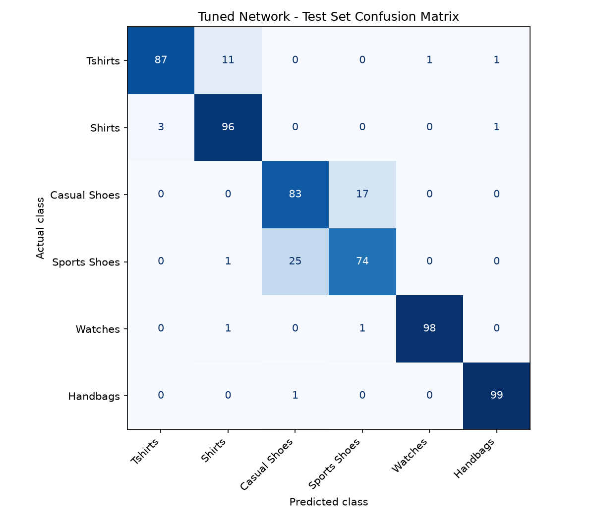

| **Category** | **Baseline** | **Dropout** | **Augmentation** | **Tuned** |
|---|---|---|---|---|
| Handbags | 99% | 99% | 99% | 99% |
| Watches | 98% | 97% | 98% | 98% |
| Shirts | 95% | 95% | 93% | 96% |
| Tshirts | 94% | 94% | 90% | 87% |
| Casual Shoes | 89% | 85% | 60% | 83% |
| Sports Shoes | 79% | 79% | 86% | 74% |

The two shoe categories account for 43 of the 63 mistakes - which led us to look more closely at the shoe labels (see Error Analysis below).

___
<br>
# Transfer Learning With MobileNetV2 <a name="cnn-transfer-learning"></a>

<br>
#### Transfer Learning Overview

Our custom networks learned everything from scratch, from just 3,600 training images. Transfer Learning instead reuses a network that has already been trained on a much larger dataset.

We use **MobileNetV2**, which was trained on *ImageNet* - over a million images across 1,000 categories. Its convolutional layers already know how to detect edges, textures, shapes & object parts. We keep these layers, *freeze* them so their learned weights don't change, and train only a small set of our own layers on top, to sort what MobileNetV2 "sees" into our six categories.

We chose MobileNetV2 over VGG16 (a common choice) as it is far smaller - around 2.3 million parameters vs 14.7 million - and much faster to train on a laptop CPU. It was designed by Google to run efficiently on phones & low-cost hardware, and is widely used in practice.

Based on our earlier results, we use **Dropout** in our new layers, and **no Image Augmentation**, as it lowered accuracy on these standardised product photos.

<br>
#### Network Architecture

MobileNetV2 was trained on images around 224 x 224 pixels. Our 80 x 60 images are very small for it, so we enlarge them inside the network to 160 x 120 - keeping the same 4:3 shape, so nothing is distorted. Enlarging adds no real detail, but it lets the pre-trained filters - which were tuned to objects of a certain size - recognise our products.

MobileNetV2 also expects pixel values between -1 & 1, rather than 0 & 1, so we rescale to match how it was trained.

```python

# image size used by the pre-trained network - same 4:3 shape as our images (height, width)
TL_HEIGHT = 160
TL_WIDTH = 120

# load MobileNetV2, pre-trained on ImageNet, without its classification layers
base_model = tf.keras.applications.MobileNetV2(input_shape=(TL_HEIGHT, TL_WIDTH, config.NUM_CHANNELS),
                                               include_top=False,
                                               weights="imagenet")

# freeze the pre-trained network - its weights will not be updated during training
base_model.trainable = False

# input: our original 80 x 60 images
inputs = tf.keras.Input(shape=(config.IMG_HEIGHT, config.IMG_WIDTH, config.NUM_CHANNELS))

# enlarge to the size used by the pre-trained network
x = tf.keras.layers.Resizing(TL_HEIGHT, TL_WIDTH)(inputs)

# rescale pixel values from 0-255 to -1 to 1 - the range MobileNetV2 was trained on
x = tf.keras.layers.Rescaling(1./127.5, offset=-1)(x)

# the frozen pre-trained network
x = base_model(x, training=False)

# summarise each of the 1,280 feature maps into one number
x = tf.keras.layers.GlobalAveragePooling2D()(x)

# our own dense layer, with Dropout
x = tf.keras.layers.Dense(128, activation="relu")(x)
x = tf.keras.layers.Dropout(0.5)(x)

# output layer
outputs = tf.keras.layers.Dense(config.NUM_CLASSES, activation="softmax")(x)

model = tf.keras.Model(inputs=inputs, outputs=outputs, name="transfer_learning_cnn")

```

<br>
The network has **2,422,726 parameters** in total, but **only 164,742 (7%) are trained** - fewer than any of our custom networks. The frozen 93% does the "seeing", and our new layers only learn how to sort what it sees.

Instead of *Flatten*, we use *Global Average Pooling*, which averages each of MobileNetV2's 1,280 feature maps into a single number. Flattening its 5 x 4 x 1,280 output would have given 25,600 values, and around 3.3 million parameters in our Dense layer - far more room to overfit.

<br>
#### Training The Network

As only a small number of parameters are learned, on top of features that are already very good, Transfer Learning converges quickly - so we train for 20 epochs rather than 50.

<br>
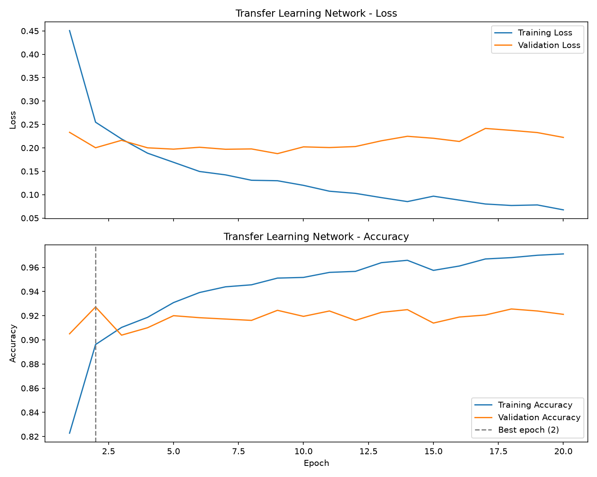

<br>
The network reached **90.5% validation accuracy after just 1 epoch**, and its best (**92.7%**) at epoch 2 - our custom networks took 20-40 epochs to reach similar levels. It is also the most stable network - after a dip at epoch 3, validation accuracy stays between 91.0% & 92.6%.

There is some mild overfitting from around epoch 9 - training accuracy rises to 97%, while validation loss creeps up from its lowest point (0.19).

**Note:** the saved network is from epoch 2, as it has the highest validation accuracy. As validation accuracy is so flat, epoch 2 only "won" by a fraction of a point - monitoring validation loss instead would have saved epoch 9, a more settled network.

<br>
#### Performance On The Test Set

On the Test Set, the Transfer Learning network achieved **92.7%** accuracy (556 of 600) - matching the best custom network (the baseline, with 554), but with far more realistic confidence (test loss of 0.23 vs 0.58).

<br>
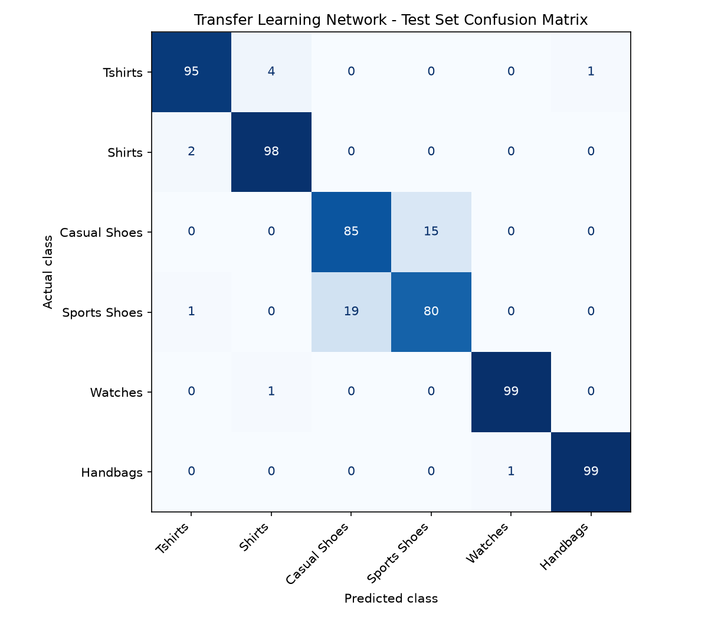

| **Category** | **Baseline** | **Dropout** | **Augmentation** | **Tuned** | **Transfer Learning** |
|---|---|---|---|---|---|
| Watches | 98% | 97% | 98% | 98% | **99%** |
| Handbags | 99% | 99% | 99% | 99% | **99%** |
| Shirts | 95% | 95% | 93% | 96% | **98%** |
| Tshirts | 94% | 94% | 90% | 87% | **95%** |
| Casual Shoes | 89% | 85% | 60% | 83% | **85%** |
| Sports Shoes | 79% | 79% | 86% | 74% | **80%** |

The Transfer Learning network has the best or joint-best accuracy on 4 of the 6 categories, and no category drops as low as in the Augmentation (Casual Shoes 60%) or Tuned (Sports Shoes 74%) networks.

The shoe categories improved only slightly (80-85%). Even a network pre-trained on over a million images struggles to separate them - which supports our findings in the next section.

Using the same 90% confidence rule as before, the Transfer Learning network could auto-tag **70% of products at 98.3% accuracy** - the most accurate auto-tagging of any network - with the remaining 181 products sent for review.

___
<br>
# Error Analysis <a name="error-analysis"></a>

Across every network, the two shoe categories caused the most mistakes - and the network's errors swung from one shoe category to the other depending on the network. We wanted to understand why.

<br>
#### Is It The Labels?

Our first hypothesis was that the shoe *labels* were unreliable. When we looked at the baseline network's most confident mistakes, some looked like they might be mislabelled, and a manual review of a random sample of shoe images suggested many were hard to assign to a category.

To test this properly, we checked each shoe's label against two other columns in `styles.csv` - the product name, and the `usage` column - across all 4,881 shoes in the dataset.

```python

# load product details & keep the two shoe categories
styles = pd.read_csv(config.STYLES_CSV, on_bad_lines="skip")
shoes = styles.loc[styles["articleType"].isin(["Casual Shoes", "Sports Shoes"])].copy()

# what does each product's name say? look for the words "sport" or "casual"
product_name = shoes["productDisplayName"].str.lower()

shoes["name_says"] = "neither"
shoes.loc[product_name.str.contains("sport"), "name_says"] = "Sports Shoes"
shoes.loc[product_name.str.contains("casual"), "name_says"] = "Casual Shoes"

# of the products whose name mentions a category, how many agree with the label?
named = shoes.loc[shoes["name_says"] != "neither"]
name_agreement = (named["name_says"] == named["articleType"]).mean()

# does the usage column agree? Casual Shoes should be "Casual", Sports Shoes should be "Sports"
expected_usage = shoes["articleType"].map({"Casual Shoes": "Casual", "Sports Shoes": "Sports"})
usage_agreement = (shoes["usage"] == expected_usage).mean()

>> Names mentioning a category: 2664 - agree with the label: 99.4%
>> Usage agrees with the label: 98.5%

```

The labels are consistent. Of the 2,664 shoes whose name mentions "sport" or "casual", 99.4% match their label, and the `usage` column matches the label for 98.5% of all 4,881 shoes. Our first hypothesis was wrong - so we revised it.

<br>
#### What The Network Is Being Asked To See

Looking at the tuned network's 8 most confident shoe mistakes, alongside their product names:

<br>
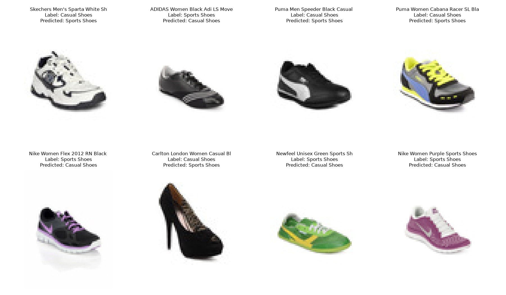

<br>
5 of the 8 show genuine *visual overlap* between the categories - Casual Shoes that look sporty (such as a "Cabana Racer"), and Sports Shoes that look like everyday sneakers. The categories are defined by how a shoe is *intended to be used*, rather than how it looks - and an image only shows the look. This places a limit on how well any image-only network can separate them.

The other 3 are clear network errors - two obvious running shoes predicted as Casual Shoes, and a high-heeled shoe predicted as Sports Shoes - so there is still room for improvement.

<br>
#### Other Mistakes

* **Images that don't show the product** - one product labelled as a Watch was photographed only showing the clothing worn by the model. The label is correct, but no image-based network could get it right
* **Polo T-shirts** - several T-shirts were predicted as Shirts, and some of these are polo T-shirts, whose collars & buttons look shirt-like
* **The same images** were misclassified by several different networks - suggesting these images are genuinely hard, rather than any one network being at fault

___
<br>
# Overall Results Discussion <a name="cnn-results"></a>

Across our five networks, we saw:

| **Network** | **Test Accuracy** | **Test Loss** | **Auto-Tagged At 90% Confidence** |
|---|---|---|---|
| Baseline | 92.3% | 0.58 | - |
| Baseline + Dropout | 91.5% | 0.38 | 88% at 96.0% accuracy |
| Baseline + Image Augmentation | 87.7% | 0.35 | 66% at 97.5% accuracy |
| Tuned + Image Augmentation | 89.5% | 0.33 | 75% at 97.3% accuracy |
| Transfer Learning (MobileNetV2) | **92.7%** | **0.23** | 70% at **98.3%** accuracy |

The **Transfer Learning** network was the strongest overall. It matched the accuracy of our best custom network, with by far the most realistic confidence, the best accuracy across categories, and just 20 epochs of training.

Some key lessons from the project:

* **Accuracy alone hides a lot** - the baseline network scored well, but had memorised its training data, and was almost 100% confident even when wrong. Test loss, category accuracy & the network's mistakes told us far more
* **Small differences are not always real** - training the same network twice changed its result by a few images, so we treated differences of a few images between networks as noise
* **Techniques should match the data** - Image Augmentation is often recommended, but on these highly standardised product photos it lowered accuracy
* **Test hypotheses with data** - we initially believed the shoe labels were unreliable, but checking them against the product names showed they were correct, and pointed us to the real cause

From a business point of view, the choice of network depends on what the client values. The Transfer Learning network gives the most accurate auto-tagging (98.3% on 70% of products), while the Dropout network automates more of the work (88% of products) at slightly lower accuracy (96.0%). Either way, using the network's confidence to decide which products to auto-tag - and which to send to the team - is far more useful than replacing the manual process entirely.

___
<br>
# Growth & Next Steps <a name="growth-next-steps"></a>

The proof of concept was successful - we have shown that a network can categorise most products very accurately, and can tell the team which of its predictions to trust.

There are several ways we could take this further:

* **More categories & better images** - test the approach on more of the 140+ product categories, using the full-resolution version of the dataset
* **Fine-tuning** - unfreeze some of MobileNetV2's later layers and train them at a low learning rate, and compare against newer pre-trained networks such as EfficientNetV2
* **Combining image & text** - the product name often states the category directly. A network that uses both the image & the name could separate categories like Casual & Sports Shoes, which images alone cannot fully tell apart
* **More robust comparisons** - train each network several times with different random seeds and compare average performance, and choose the confidence threshold using the validation set
* **Saving the best epoch by validation loss** - rather than validation accuracy, which can pick an early, less settled network when accuracy is flat